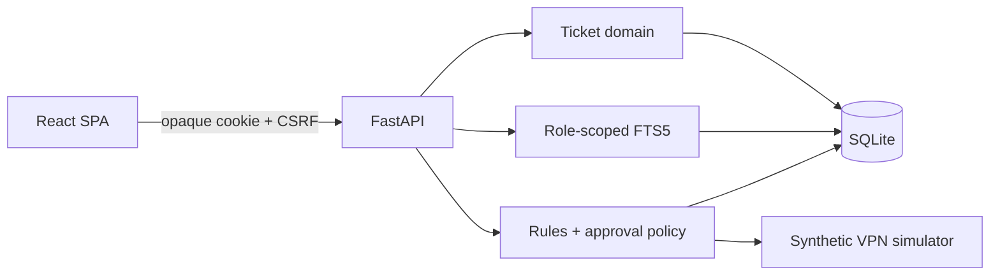
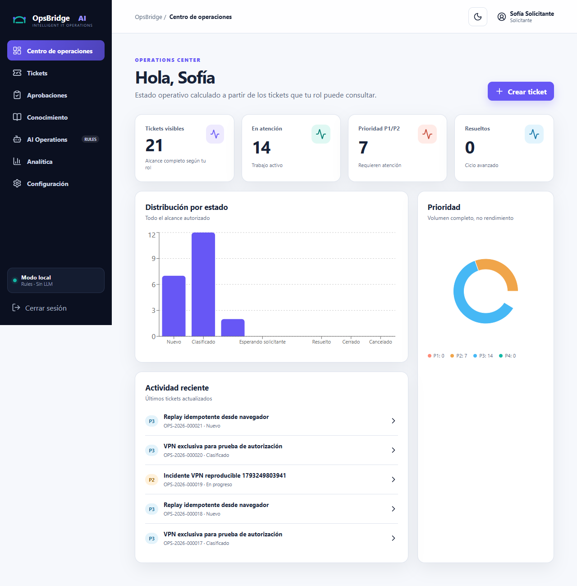
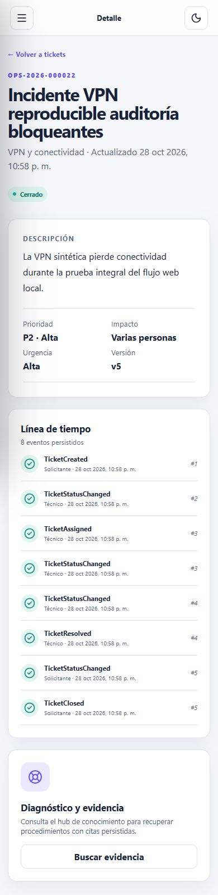

# OpsBridge AI

OpsBridge is a local IT operations portfolio application demonstrating backend and frontend engineering, security, cited knowledge retrieval, and human-governed automation. It uses synthetic data and systems only; it is not production-ready and never controls real infrastructure.

Owner: **Yerlan Daniel Gómez Hernández**. Built with Codex assistance under the owner's direction and validation.

Release candidate: **v1.0.0-rc.1** (Python `1.0.0rc1`, npm `1.0.0-rc.1`).

## Verified scope

- FastAPI ticket domain, SQLAlchemy/Alembic persistence, transactions, events, ETags, and persistent idempotency.
- Opaque local sessions, Argon2id, CSRF, exact Origin checks, rate limiting, RBAC, and resource authorization tests.
- React/TypeScript/Vite UI for dashboards, tickets, timelines, analytics, knowledge, and approvals.
- Role-scoped SQLite FTS5 retrieval with real citations and abstention. This is lexical retrieval, not a generative model.
- Deterministic Rules mode and an approval-bound, exactly-once `DEMO-VPN-NNN` simulator action.
- Honest mode reporting: Ollama/local LLM is **not verified** (`LOCAL_LLM_PENDING`).

## Windows quick start

Verified environment: Python 3.12, Node 24, and pnpm. Python 3.11 remains untested.

1. `cd backend; .\scripts\setup.ps1`
2. `cd ..\frontend; pnpm install --frozen-lockfile`
3. Create requester, technician, and approver users interactively with `backend\scripts\create-user.ps1`; no default passwords exist.
4. To keep OpsBridge separate from DataTrust, run `.\scripts\start_demo.ps1 -BackendPort 8768`. The script refuses to replace a process already using either port.
5. Open `http://127.0.0.1:5173`; OpenAPI is at `http://127.0.0.1:8768/docs`; stop with `.\scripts\stop_demo.ps1`.

See the [full Windows guide](docs/GUIA_INSTALACION_WINDOWS.md) and [recruiter demo](docs/GUIA_DEMO_RECLUTADOR.md).

## API and visual evidence

OpenAPI is served locally at `/docs`. The main routes cover local authentication, ticket listing and aggregate summaries, server-authorized transitions and timelines, cited knowledge search, proposals, independent decisions, and simulated executions. See the [reviewed contract](docs/API_DESIGN.md).

| Desktop | Mobile |
|---|---|
|  |  |

GitHub Actions validates Python 3.12 with Ruff, formatting, strict mypy, pytest, `pip check`, and migrations. The frontend job runs a frozen install, TypeScript, ESLint, Vitest, and a production build. Four Playwright journeys remain local evidence because they depend on interactively created synthetic accounts; no demo password is published in CI.

## Evidence and limits

As of 2026-10-29: 215 backend tests, strict mypy/Ruff checks, frontend typecheck/lint/build, 7 component tests, and 4 real Chrome E2E flows passed. The 13-case synthetic retrieval set produced recall@3 1.0, precision@3 1.0, and abstention accuracy 1.0. These small local results are not an SLA or enterprise-quality claim.

SQLite is a single-writer local choice; only a VPN simulator exists; no real LLM was run; Firefox/Safari and Python 3.11 remain untested. `pip-audit` and `pnpm audit` found no known vulnerabilities in published dependencies; the editable local package is not available on PyPI and was skipped. See [verified results](docs/RESULTADOS_VERIFICADOS.md), [open issues](docs/ISSUES_PENDIENTES.md), and [security policy](SECURITY.md).

Licensed under the [MIT License](LICENSE), copyright 2026 Yerlan Daniel Gómez Hernández.
