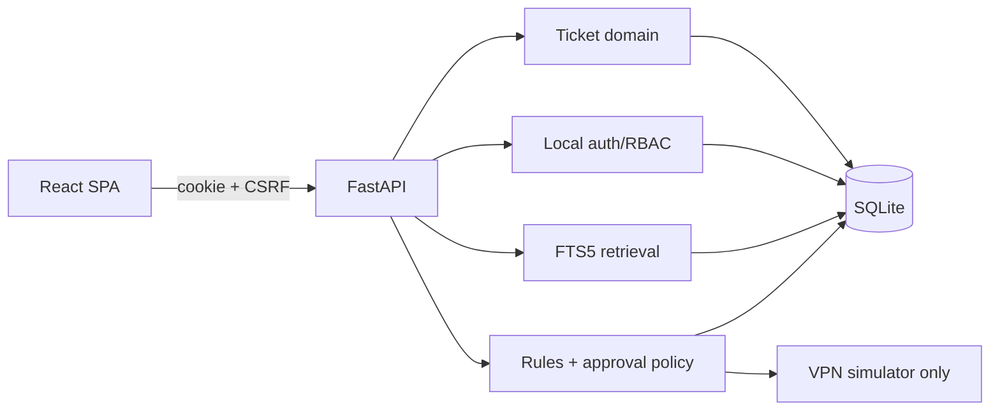

# OpsBridge AI

Plataforma local de operaciones TI para demostrar ingeniería backend, frontend, seguridad, recuperación documental y automatización con aprobación humana. Usa exclusivamente datos y sistemas sintéticos; no está preparada para exposición pública ni controla infraestructura real.

Responsable: **Yerlan Daniel Gómez Hernández**. Desarrollo asistido por Codex bajo dirección y validación del responsable. [English version](README.en.md).

Versión candidata: **v1.0.0-rc.1** (Python `1.0.0rc1`, npm `1.0.0-rc.1`).

## Qué problema aborda

OpsBridge concentra solicitudes, estados, evidencia y decisiones en un recorrido verificable. Un solicitante registra un incidente; un técnico consulta procedimientos locales citados y propone una acción; un aprobador independiente decide; el servidor vuelve a validar política, versión, hash y caducidad antes de ejecutar una única acción en un simulador VPN.

## Capacidades verificadas

- FastAPI, dominio de tickets, SQLAlchemy/Alembic y SQLite con transacciones, eventos, ETag e idempotencia.
- Sesiones locales opacas, Argon2id, CSRF, Origin exacto, rate limiting, RBAC e IDOR/BOLA probado.
- React/TypeScript/Vite con dashboard, tickets, timeline, analítica, conocimiento y aprobaciones.
- FTS5 con citas, permisos de documento y abstención. Es recuperación léxica, no un LLM.
- Rules + propuesta/aprobación/ejecución exactamente una vez sobre `DEMO-VPN-NNN`.
- Estado honesto: Ollama/modelo local **no verificado** (`LOCAL_LLM_PENDING`).

## Inicio local en Windows

Requisitos comprobados: Python 3.12 y Node 24 con pnpm. Python 3.11 está previsto pero no fue ejecutado.

1. `cd backend; .\scripts\setup.ps1`
2. `cd ..\frontend; pnpm install --frozen-lockfile`
3. Cree tres usuarios con contraseñas introducidas interactivamente usando `backend\scripts\create-user.ps1`: `demo.requester`/requester, `demo.technician`/technician y `demo.approver`/approver.
4. Desde la raíz: `.\scripts\start_demo.ps1 -BackendPort 8768` para mantener separación de DataTrust. El script se niega a iniciar si algún puerto está ocupado.
5. Abra `http://127.0.0.1:5173`; OpenAPI queda en `http://127.0.0.1:8768/docs`. Detenga con `.\scripts\stop_demo.ps1`.

Los scripts no cambian la política de PowerShell, no requieren administrador, no instalan credenciales predeterminadas y solo enlazan a loopback. La [guía completa](docs/GUIA_INSTALACION_WINDOWS.md) incluye pruebas y solución de problemas.

## Demo en cinco pasos

1. Solicitante: crear un ticket VPN con datos ficticios.
2. Técnico: revisar detalle/timeline y consultar “vpn sesión bloqueada” en Conocimiento.
3. Técnico: proponer reset de `DEMO-VPN-001`; la propuesta no ejecuta nada.
4. Aprobador: revisar hash, expiración y aprobar desde otra sesión.
5. Técnico: ejecutar el simulador una vez y comprobar estado/auditoría.

## API y evidencia visual

OpenAPI se sirve localmente en `/docs`. Las rutas principales son autenticación local, tickets y resumen agregado, opciones/transiciones/timeline, búsqueda documental, propuestas, decisiones y ejecuciones simuladas. El [contrato detallado](docs/API_DESIGN.md) distingue lo implementado de lo planificado.

| Escritorio | Móvil |
|---|---|
|  |  |

GitHub Actions ejecuta Python 3.12 con Ruff, formato, mypy estricto, pytest, `pip check` y migraciones; para frontend ejecuta instalación congelada, TypeScript, ESLint, Vitest y build. Los cuatro recorridos Playwright permanecen como evidencia local porque requieren cuentas sintéticas creadas interactivamente y no se publican contraseñas en CI.

## Verificación al corte 2026-10-29

- Backend: Ruff y mypy limpios; **215 pruebas** aprobadas; `pip check` limpio.
- Frontend: TypeScript/ESLint/build, 7 componentes y 4 E2E Chrome aprobados.
- Retrieval sintético: 13 casos; recall@3 1.0, precision@3 1.0, abstención 1.0.
- `pnpm audit` y `pip-audit`: sin vulnerabilidades conocidas en dependencias publicadas; el paquete editable local no existe en PyPI y `pip-audit` lo omite.
- Sin P0/P1 conocidos; los P2 están en [issues pendientes](docs/ISSUES_PENDIENTES.md).

Estas métricas pertenecen a un dataset pequeño y local; no constituyen SLA, exactitud empresarial ni garantía de seguridad absoluta.

## Seguridad, privacidad y límites

- Localhost por defecto; CORS exacto; sin servicios de pago ni telemetría externa.
- Sin secretos, cuentas o documentos reales en el proyecto.
- SQLite es apropiado para la demo local, no para escala empresarial.
- El historial es trazabilidad local, no un ledger inmutable.
- Solo el simulador VPN está implementado; no hay shell, SSO, correo o red corporativa.
- Licencia [MIT](LICENSE), copyright 2026 Yerlan Daniel Gómez Hernández.

Consulte [SECURITY.md](SECURITY.md), [arquitectura final](docs/ARQUITECTURA_FINAL.md), [resultados verificados](docs/RESULTADOS_VERIFICADOS.md) y [guía de demo](docs/GUIA_DEMO_RECLUTADOR.md).
