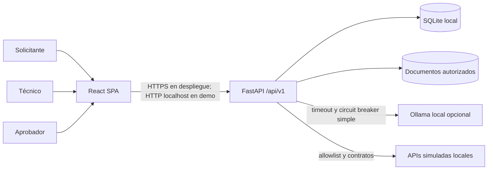
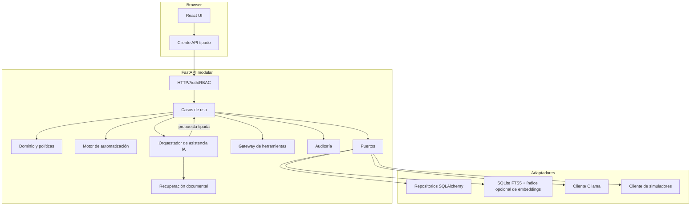
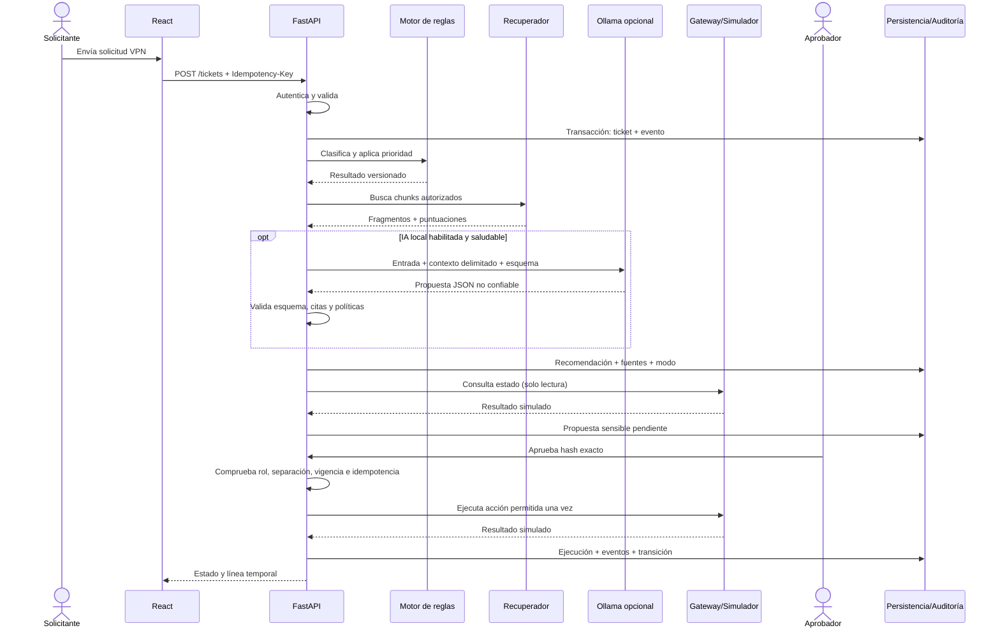

# Arquitectura — OpsBridge AI

**Estado:** diseño aprobado internamente para revisión del responsable  
**Fase:** 1  
**Estilo:** monolito modular local con puertos y adaptadores

## 1. Resumen de decisión

OpsBridge AI comenzará como un monolito modular: una API FastAPI, una SPA React y procesos locales explícitos para API, simuladores y Ollama opcional. El dominio conserva las reglas, los casos de uso coordinan transacciones y los adaptadores conectan persistencia, recuperación, modelo y herramientas. Esta forma permite demostrar fronteras profesionales sin añadir la operación y consistencia distribuida de microservicios.

La decisión más importante es separar autoridad de asistencia:

- **Motor determinista:** estados, prioridad, RBAC, políticas, aprobaciones, idempotencia y ejecución.
- **Subsistema de IA:** propone clasificación y recomendaciones fundamentadas; no cambia estado ni ejecuta herramientas.
- **Gateway de herramientas:** solo acepta comandos tipados desde casos de uso autorizados, no texto generado.

## 2. Objetivos arquitectónicos

1. Funcionar completamente en modo básico por reglas, etiquetado como tal.
2. Permitir sustituir Ollama o el recuperador sin contaminar el dominio.
3. Aislar efectos externos detrás de interfaces comprobables.
4. Conservar una pista explicable desde entrada hasta resultado.
5. Favorecer pruebas rápidas sin impedir pruebas reales de integración.
6. Evolucionar SQLite a PostgreSQL con migraciones y un repositorio SQLAlchemy común.

## 3. Contexto del sistema



Solo el backend se comunica con Ollama y simuladores. El navegador no conoce credenciales, endpoints internos ni políticas ejecutables.

## 4. Contenedores y componentes



### 4.1 Responsabilidades

| Componente | Responsabilidad | No debe hacer |
|---|---|---|
| HTTP | Deserializar, autenticar, autorizar la operación, correlacionar y mapear errores | Contener reglas empresariales |
| Casos de uso | Coordinar dominio, repositorios, transacción y eventos | Construir SQL o prompts ad hoc |
| Dominio | Entidades, valores, transiciones e invariantes puras | Importar FastAPI, SQLAlchemy u Ollama |
| Automatización | Taxonomía, matriz de prioridad, selección determinista de playbook | Presentarse como IA |
| Orquestador IA | Recuperar contexto, construir prompt, pedir salida estructurada y validar | Ejecutar herramientas o aprobar |
| Recuperación | Ingesta, fragmentación, filtros de autorización, ranking y citas | Interpretar instrucciones de los documentos como política |
| Gateway | Allowlist, validación, autorización, idempotencia, timeout y adaptación | Aceptar nombre/esquema definidos por el LLM |
| Auditoría | Eventos append-only saneados y correlacionados | Almacenar secretos, tokens o prompts completos por defecto |
| Repositorios | Persistencia y consultas | Decidir transiciones |

## 5. Capas y dependencias

```text
presentation -> application -> domain
                     |          ^
                     v          |
                   ports -------+
                     ^
                     |
                infrastructure
```

`domain` no depende de frameworks. `application` depende de dominio y puertos abstractos. `infrastructure` implementa puertos. `presentation` convierte HTTP a comandos/consultas. La composición se realiza en un único punto de arranque.

## 6. Modelo de dominio y datos

Entidades principales:

- `User`, `Role`, `Session`.
- `Ticket`, `TicketComment`, `TicketTransition`.
- `ClassificationRun` con `mode`, reglas/modelo, propuesta y revisión.
- `KnowledgeDocument`, `DocumentVersion`, `DocumentChunk`.
- `RetrievalRun`, `Citation`, `Recommendation`.
- `ToolActionProposal`, `ApprovalRequest`, `ApprovalDecision`, `ActionExecution`.
- `AuditEvent`, `IdempotencyRecord`.
- `IntegrationHealthSnapshot` para diagnósticos locales sin convertirlo en fuente de verdad.

Principios de esquema:

- UUID v4 interno; código legible separado.
- UTC en persistencia, zona local solo en presentación.
- Enums validados en aplicación y restricciones `CHECK`/FK donde sea posible.
- Versionado optimista en agregados mutables mediante `version` y `ETag`/`If-Match` para evitar sobrescrituras.
- Eventos de auditoría append-only desde la aplicación; una base local no ofrece inmutabilidad antiforense, limitación que se declara.
- Texto de ticket separado de campos normalizados; nunca incluir credenciales.
- Parámetros de acción almacenados como JSON canónico y hash SHA-256 para enlazar aprobación y ejecución.

### 6.1 Evolución SQLite → PostgreSQL

SQLite será suficiente para una demo de un solo nodo. Se usará SQLAlchemy y Alembic, tipos portables, claves externas habilitadas y transacciones cortas. WAL se evaluará para concurrencia local. No se dependerá de sintaxis FTS en repositorios de dominio: la recuperación tendrá un puerto propio.

El cambio a PostgreSQL se considera cuando pruebas demuestren necesidad de concurrencia multiusuario, bloqueos más finos o despliegue persistente. Antes de migrar se ejecutará la misma suite de contratos contra ambos motores y se reemplazará FTS5 por el adaptador acordado. SQLite no debe usarse como evidencia de escalabilidad.

## 7. Flujo del caso VPN



Si Ollama falla, se registra `ai_unavailable`; las reglas y recuperación léxica pueden continuar. Si falla el simulador en una consulta, el ticket sigue operativo. Ante un timeout mutante ambiguo, la ejecución pasa a `unknown` y requiere reconciliación; no se reintenta a ciegas.

## 8. IA, RAG y automatización

### 8.1 Clasificación

El baseline por reglas usa palabras/expresiones, campos de formulario y matriz de prioridad versionada. La IA recibe una taxonomía cerrada y devuelve un esquema Pydantic con categoría, señales, resumen y grado de seguridad declarado. Un valor de confianza del modelo no se interpreta como probabilidad calibrada hasta evaluarlo. Categorías desconocidas o salida inválida causan abstención/revisión.

### 8.2 Recuperación

Pipeline inicial:

1. Ingesta solo desde directorio administrado y manifiesto permitido.
2. Normalización de texto; metadatos de versión, sección, checksum y autorización.
3. Fragmentación determinista con solapamiento configurado y prueba de regresión.
4. Búsqueda léxica FTS5 siempre disponible.
5. Embeddings locales opcionales mediante Ollama; índice simple local detrás de un puerto, sin base vectorial externa en la primera versión.
6. Fusión/reranking determinista y filtros por estado/versión.
7. Evidencia insuficiente si no supera umbrales derivados del conjunto de evaluación; no se inventa respuesta.

Los fragmentos se delimitan como evidencia no confiable. El prompt prohíbe seguir instrucciones encontradas en documentos, pero la seguridad real depende de que ninguna salida pueda saltarse el gateway.

### 8.3 Generación fundamentada

La recomendación usa salida estructurada: resumen, pasos, advertencias, `citation_ids`, necesidad de escalamiento y posibles acciones de catálogo. El backend valida que cada cita pertenezca al conjunto recuperado y que cada afirmación operativa crítica tenga apoyo. La UI diferencia texto proveniente de reglas, plantilla o IA.

### 8.4 Tool calling

Aunque Ollama soporta tool calling, OpsBridge AI no entregará funciones ejecutables directamente al modelo en la primera iteración. El modelo puede proponer un `action_type` enumerado; la aplicación lo convierte en `ToolActionProposal`. El gateway recompone el comando desde modelos internos, aplica RBAC/política/aprobación y llama al simulador. Esto hace que un prompt injection no tenga una ruta directa a efectos.

### 8.5 ¿Por qué no LangGraph inicialmente?

El flujo es una máquina de estados de negocio persistida y explícita. Casos de uso Python sencillos son más fáciles de probar, auditar y enseñar. LangGraph solo se reevaluará si aparecen ciclos de agentes, reanudación compleja o branching que el diseño actual no pueda expresar con claridad. Incorporarlo requiere ADR, pruebas equivalentes y evidencia de beneficio.

## 9. Seguridad de arquitectura

- Sesión opaca de servidor en cookie `HttpOnly`, `SameSite=Lax`, `Secure` fuera de localhost; token CSRF en mutaciones.
- Contraseñas sintéticas hasheadas con Argon2id y rotables; sin secretos en repositorio.
- RBAC más controles de propiedad y separación de funciones en casos de uso.
- CORS restringido al origen de frontend en desarrollo; preferir mismo origen en empaquetado local.
- Límites de tamaño, tipos y contenido; HTML se renderiza escapado y Markdown sanitizado.
- Timeouts, límite de concurrencia y circuit breaker simple para Ollama/simuladores.
- Redacción estructurada en logs; prompts completos desactivados por defecto.
- El backend solo permite loopback para adaptadores locales en la demo, mitigando SSRF.
- Cabeceras CSP, `frame-ancestors`, `nosniff` y política de referrer desde el servidor que entregue la SPA.

El modelo de amenazas detallado está en `SECURITY_AND_TESTING.md`.

## 10. API, procesos y operación local

Procesos previstos:

1. `backend`: FastAPI/Uvicorn en loopback.
2. `frontend`: Vite en desarrollo; build estático servido en mismo origen en demo integrada.
3. `simulator`: API FastAPI separada solo en loopback para probar fallos y contratos; no es un microservicio de producción.
4. `ollama`: proceso opcional del usuario.

No se requiere Docker; se ofrecerá posteriormente como conveniencia. Configuración mediante `.env` validado: URLs loopback, base de datos, TTL, flags de IA, modelos, límites y nivel de log. Los secretos se suministran fuera del control de versiones.

Health endpoints:

- `/health/live`: proceso vivo, sin dependencias.
- `/health/ready`: base/migración disponibles; no exige Ollama si IA es opcional.
- `/api/v1/integrations/status`: estado autorizado y explícito de Ollama/simulador.

## 11. Estructura prevista

```text
OpsBridge_AI/
├── AGENTS.md
├── README.md
├── docs/
│   ├── adr/
│   ├── API_DESIGN.md
│   ├── ARCHITECTURE.md
│   ├── IMPLEMENTATION_PLAN.md
│   ├── PRODUCT_REQUIREMENTS.md
│   ├── PROJECT_STATE.md
│   └── SECURITY_AND_TESTING.md
├── backend/
│   ├── alembic/
│   ├── src/opsbridge/
│   │   ├── presentation/http/
│   │   ├── application/
│   │   ├── domain/
│   │   ├── ports/
│   │   └── infrastructure/{db,ai,retrieval,tools,logging}/
│   └── tests/{unit,integration,contract,security}/
├── frontend/
│   ├── src/{app,features,components,lib,styles}/
│   └── tests/
├── simulators/
│   └── support_api/
├── evals/
│   ├── datasets/
│   ├── runners/
│   └── reports/
├── knowledge_base/
│   ├── approved/
│   └── manifests/
└── scripts/
```

La estructura es objetivo, no archivos ya implementados.

## 12. Tecnologías y compatibilidad

| Área | Selección | Justificación/estado |
|---|---|---|
| Runtime backend | Python 3.11 o 3.12 | Metadatos limitados a ambas versiones; Python 3.12.14 verificado en Fase 2.0 y Python 3.11 pendiente de ejecución local |
| API | FastAPI + Pydantic v2 | OpenAPI, tipado y validación; FastAPI actual requiere Pydantic v2. Fijar minor/patch tras prueba |
| ORM/migración | SQLAlchemy 2.1 + Alembic | SQLAlchemy 2.1.6 y Alembic 1.20.1 instalados y verificados con Python 3.12.14 en Fase 2.0 |
| DB | SQLite; PostgreSQL como evolución | Cero servicio obligatorio en demo; contrato de repositorio aislado |
| Frontend | React + TypeScript + Vite | SPA tipada y toolchain simple; usar Node LTS compatible con la versión fijada de Vite |
| Pruebas | pytest, HTTPX, Playwright | Cobertura por capa y navegador real |
| IA local | Ollama por HTTP | API local, salidas estructuradas, embeddings; disponibilidad/hardware no asumidos |
| Recuperación | FTS5 + embeddings opcionales | Baseline sin modelo; evita dependencia vectorial prematura |

Comprobaciones de documentación oficial al 2026-10-27:

- FastAPI documenta el uso de Pydantic v2 y recomienda fijar rangos y validar upgrades: <https://fastapi.tiangolo.com/deployment/versions/>.
- SQLAlchemy 2.0 soporta Python 3.7+; SQLAlchemy 2.1 comienza en Python 3.11. La serie concreta se fijará después de probar el runtime: <https://docs.sqlalchemy.org/en/21/changelog/migration_21.html>.
- Las versiones actuales de Vite cambian soporte con el ciclo de Node; su página de releases exige mantener versiones soportadas y fijar minors cuando los tipos importan: <https://vite.dev/releases>.
- Playwright requiere Node 20 o superior en su guía actual: <https://playwright.dev/docs/getting-started-cli>.
- Ollama local expone API sin clave en `localhost`, pero su API no tiene versionado estricto: <https://docs.ollama.com/api/introduction>. El adaptador debe tener pruebas de contrato.
- Ollama documenta JSON Schema, tool calling y embeddings; soporte real depende del modelo instalado: <https://docs.ollama.com/capabilities/structured-outputs>, <https://docs.ollama.com/capabilities/tool-calling>, <https://docs.ollama.com/capabilities/embeddings>.

No se fijan números exactos en Fase 1 porque todavía no existe lockfile ni prueba del equipo. Fase 2 deberá inventariar Python/Node, seleccionar releases estables soportados, bloquear transitivas y registrar evidencia.

## 13. Decisiones y alternativas

| Decisión | Alternativa descartada por ahora | Razón |
|---|---|---|
| Monolito modular | Microservicios | Menos fallos distribuidos, despliegue local simple, fronteras suficientes |
| SQLAlchemy | ORM más ligero/código SQL directo | Migraciones y portabilidad justifican el costo moderado |
| Sesión opaca | JWT de larga vida en navegador | Revocación y superficie de filtración más simples en entorno local |
| FTS5 + índice local | Base vectorial dedicada | Menos dependencias y baseline evaluable |
| Orquestación propia | LangGraph | Flujo actual explícito y acotado |
| REST | GraphQL | Recursos y acciones tienen contratos REST claros; OpenAPI ayuda a pruebas |
| Polling corto/refresh inicial | WebSockets | No hay requisito de tiempo real; reevaluar con evidencia UX |

## 14. Riesgos y evolución

- **Hardware IA desconocido:** ejecutar benchmark de modelos pequeños; mantener reglas y plantillas.
- **SQLite bajo concurrencia:** pruebas de contención y ruta PostgreSQL; no prometer multiusuario intensivo.
- **Calidad documental:** dataset sintético revisado, versiones y casos sin evidencia.
- **Prompt injection:** aislamiento de autoridad, filtros y suite adversarial; no confiar solo en prompts.
- **Deriva de dependencias:** lockfiles, actualización controlada y pruebas.
- **Alcance excesivo:** puertas de salida por fase y flujo VPN vertical antes de amplitud.
- **Auditoría local modificable:** declarar limitación; una demo local no ofrece almacenamiento WORM.

## 15. Nota de implementación v1.0.0-rc.1

La lista de tickets mantiene paginación por cursor opaco y tamaño 25 en la SPA. Los KPI no agregan una página parcial: `GET /api/v1/tickets/summary` ejecuta conteos agrupados en SQL con exactamente el mismo alcance por rol y filtros que el repositorio de lista. Esto evita transferir todos los tickets al navegador y conserva el aislamiento del solicitante. Los gráficos se cargan de forma diferida en un chunk independiente; SQLite sigue siendo una decisión de nodo local y no evidencia escalabilidad empresarial.
