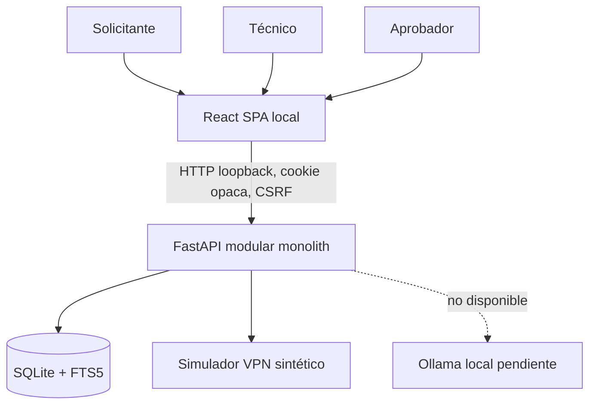
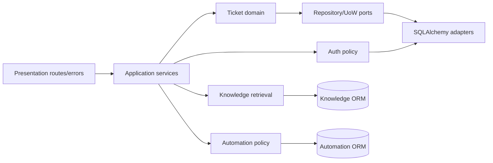
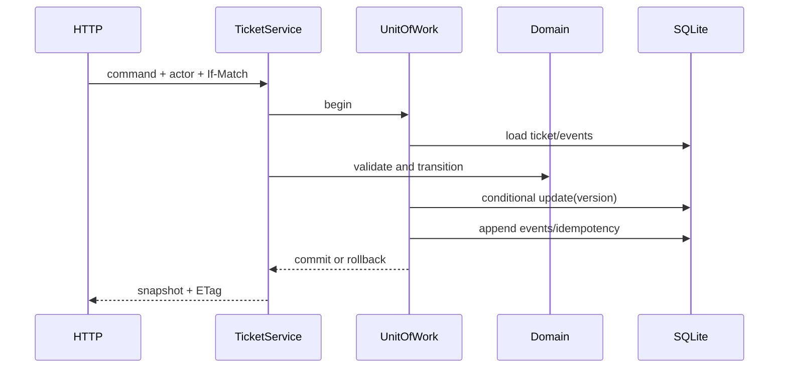
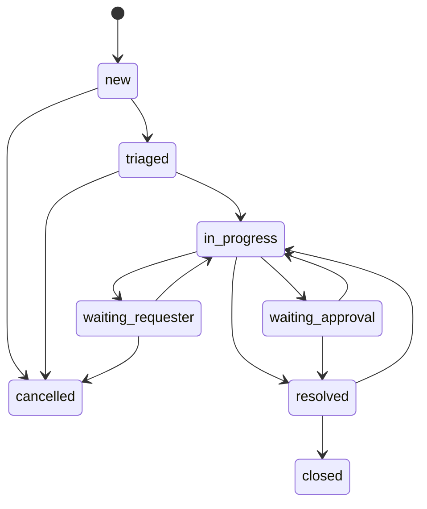
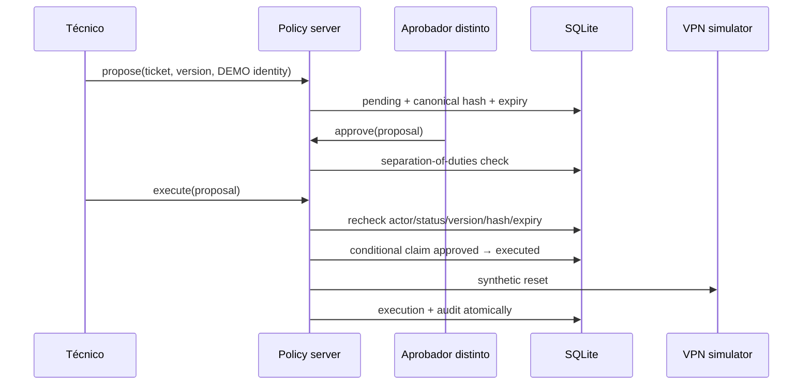
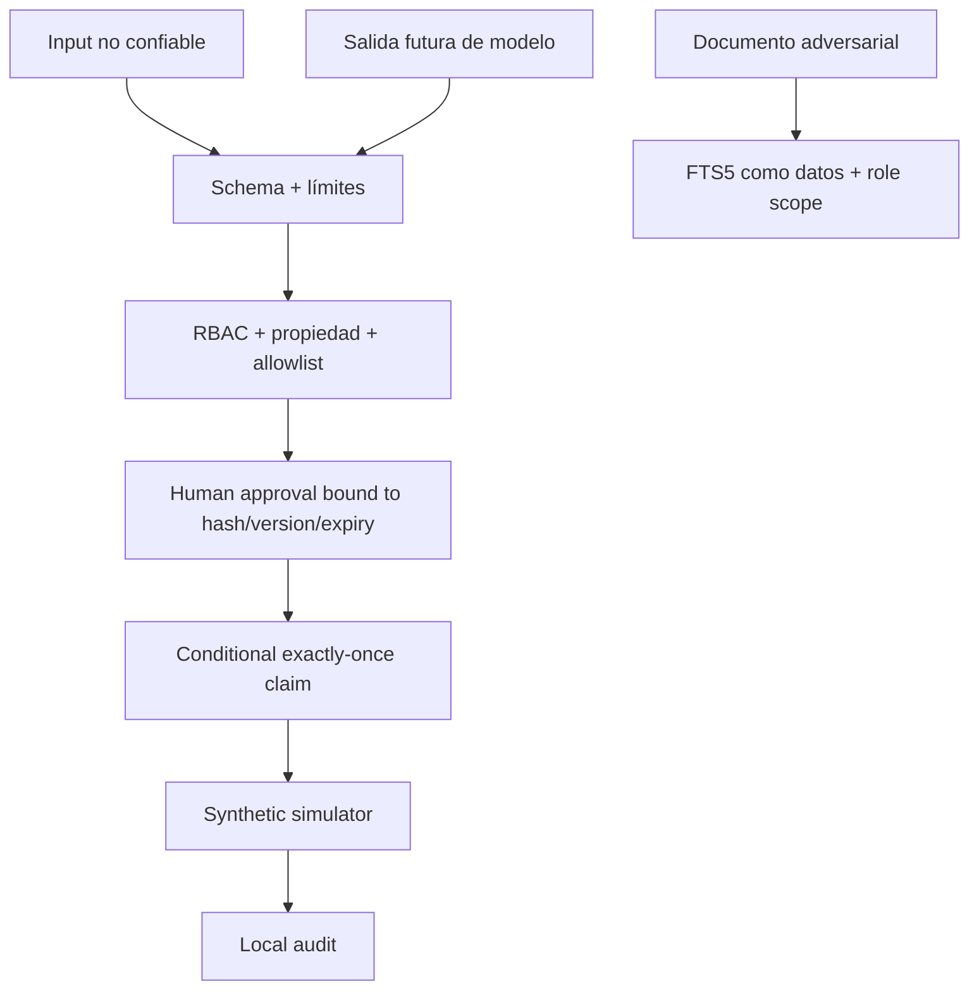

# Arquitectura final verificada

## Contexto y contenedores

No hay red corporativa, correo, SSO, nube, broker o herramienta de shell.

## Componentes backend

Tickets conserva dominio e infraestructura separados. Knowledge/Automation acceden directamente a sus ORM como deuda P2 aceptada para el alcance pequeño; si crecen deben extraer puertos.

## Flujo transaccional de ticket

## Estados

El diagrama conserva todos los estados del núcleo de dominio. En el contrato HTTP de `v1.0.0-rc.1`, las aristas hacia y desde `waiting_approval` están deliberadamente cerradas: el servidor no acepta una confirmación booleana del cliente como prueba de aprobación. El flujo gobernado VPN usa propuestas persistidas, decisión independiente y revalidación de estado, asignación y versión antes de ejecutar.

## Aprobación y efecto

## Permisos resumidos

| Recurso | Solicitante | Técnico | Aprobador |
|---|---|---|---|
| Tickets | propios, crear/transiciones permitidas | todos, modificar/transicionar | lectura global |
| Knowledge | documentos autorizados | autorizados, incluido técnico | autorizados |
| Propuestas | no | crear/listar propias/ejecutar aprobadas | listar/decidir |
| Simulador | no | consulta/ejecución gobernada | consulta, no ejecución |

## Amenazas y controles

Controles adicionales: Argon2id, cookie HttpOnly/SameSite, token CSRF derivado, Origin exacto, rate limit, 404 uniforme, RFC 9457 sin trazas, FK/WAL/busy timeout, ETag e idempotencia. Límites: auditoría mutable local, SQLite single-writer y LLM no verificado.
