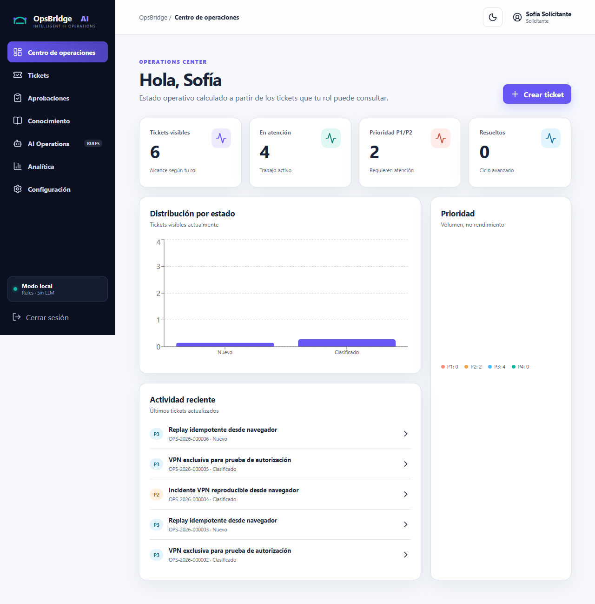
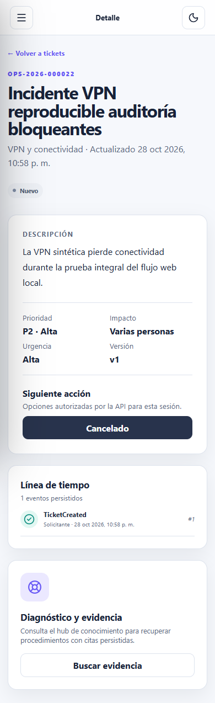

# Sistema visual — OpsBridge AI

## Dirección

Producto B2B de operaciones: navegación midnight, lienzo claro, índigo para acciones, teal para estados operativos y coral para atención. La marca SVG representa un puente entre dos nodos; no reutiliza marcas externas.

## Tokens

| Token | Claro | Uso |
|---|---|---|
| `--nav` | `#0B1020` | navegación y marca |
| `--primary` | `#6757F5` | acción principal y foco de marca |
| `--teal` | `#13B8A6` | operación correcta |
| `--sky` | `#46B8F5` | datos secundarios |
| `--coral` | `#E56856` | atención/error complementario |
| `--canvas` | `#F6F8FC` | fondo |
| `--surface` | `#FFFFFF` | cards y formularios |
| `--ink` | `#182238` | texto principal |
| `--muted` | `#58677D` | texto secundario con contraste corregido |

Espaciado basado en múltiplos de 4/8 px, cards de radio 16 px, controles mínimos de 42 px, transiciones de 160–200 ms y desactivación mediante `prefers-reduced-motion`. El tema oscuro persiste únicamente la preferencia no sensible en `localStorage`.

## Accesibilidad y responsive

HTML semántico, labels visibles, foco de 3 px, no dependencia exclusiva del color, tabla con scroll localizado, diálogo con nombre accesible, navegación adaptada y sidebar fuera del lienzo cuando está cerrado. axe y revisión visual se documentan en `FASE_3_FRONTEND_PROFESIONAL.md`.

## Capturas comprobadas

