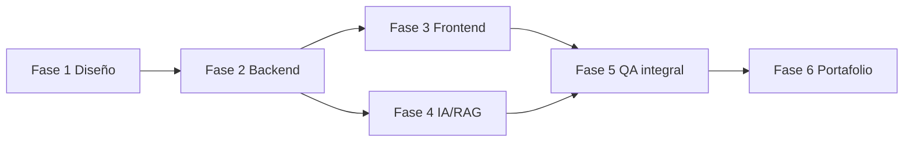

# Plan de implementación — OpsBridge AI

**Estado:** planificación; solo Fase 1 autorizada  
**Regla:** ninguna fase posterior comienza sin revisión del responsable

## 1. Método de entrega

El desarrollo seguirá cortes verticales pequeños y verificables. Cada subetapa termina con código ejecutable dentro de su alcance, pruebas dirigidas, documentación mínima actualizada y un `PROJECT_STATE.md` que permita retomar en otro chat.

Complejidad relativa:

- **S:** cambio local con pocas fronteras.
- **M:** varias clases/capas o integración acotada.
- **L:** flujo vertical, seguridad crítica o dependencia externa.
- **XL:** debe dividirse antes de iniciar.

No son estimaciones de tiempo. En cada fase se limita el trabajo simultáneo: un corte vertical en curso, defectos críticos primero y dependencias nuevas solo con justificación.

## 2. Fase 1 — Arquitectura, planificación y definición

### Entregables

- Requisitos, arquitectura, contratos API, seguridad/QA, plan y estado.
- README inicial e instrucciones persistentes.
- Flujo VPN completo y tres escenarios adicionales.
- Decisiones de IA, degradación, aprobación, simulación y evaluación.

### Criterio de finalización

- Documentos completos, terminología coherente y sin implementación prematura.
- Decisiones y pendientes explícitos.
- Responsable revisa y autoriza Fase 2.

**Complejidad:** L. **Estado:** completada por el asistente, pendiente de revisión del responsable.

## 3. Fase 2 — Backend funcional y persistencia

Objetivo: API local segura con tickets, roles, estados, auditoría y simuladores; todavía sin IA generativa.

### 2.0 Inventario y bootstrap (S)

- Confirmar Windows, Python disponible, Node LTS, SQLite/FTS5 y Git.
- Seleccionar versiones estables soportadas; crear `pyproject.toml`, lockfile, `.env.example`, `.gitignore` y comandos reproducibles.
- Configurar Ruff, tipado, pytest y estructura por capas.
- Crear ADR-001 para versión/runtime y ADR-002 para sesión/CSRF si cambia el diseño.

**Pruebas:** import limpio, lint/typecheck, config válida/inválida.  
**Salida:** backend vacío inicia en loopback y health responde.

### 2.1 Dominio de tickets (M)

- Entidades/valores de ticket, prioridad, categoría, rol y estados.
- Máquina de transiciones y matriz impacto×urgencia versionada.
- Reloj e IDs inyectables.

**Pruebas:** tabla completa de transiciones, prioridad, invariantes y casos límite.  
**Salida:** dominio sin dependencias de framework.

### 2.2 Persistencia y migraciones (L)

- SQLAlchemy/Alembic, repositorios, Unit of Work, SQLite FK y estrategia WAL.
- Tablas de usuarios/sesiones, tickets, comentarios, transiciones, auditoría e idempotencia.
- Seed sintético reproducible.

**Pruebas:** migración vacía/upgrade, constraints, rollback, concurrencia básica, repositorios.  
**Salida:** DB recreable y verificable.

### 2.3 Auth, RBAC y API de tickets (L)

- Sesión opaca, Argon2 calibrado, CSRF y rate limit local.
- Endpoints de sesión, CRUD acotado, asignación, transición, comentarios y timeline.
- Problem Details, correlación, ETag e idempotencia.

**Pruebas:** matriz rol/propiedad, cookie/CSRF, IDOR, validación, conflictos y OpenAPI.  
**Salida:** flujo solicitante→técnico por API.

### 2.4 Clasificador por reglas y plantillas (M)

- Taxonomía inicial de cuatro categorías; motor versionado.
- Recuperación léxica mínima puede diferirse a 2.6; recomendación por playbook claramente `rules`.

**Pruebas:** fixtures de cuatro escenarios, ambigüedad, no clasificación y trazabilidad de versión.  
**Salida:** demo sin LLM honesta y reproducible.

### 2.5 Simulador, propuestas y aprobaciones (L)

- API simulada local con estados/fallos configurables.
- Catálogo de herramientas, consultas read-only, propuestas inmutables, aprobación, hash, TTL y ejecución única.
- Implementar primero `service_status.get` y `vpn_session.reset`; ampliar acciones después del corte VPN.

**Pruebas:** contrato, timeout, respuesta inválida, separación de funciones, TOCTOU, replay y carrera.  
**Salida:** flujo VPN de backend hasta acción simulada.

### 2.6 Conocimiento léxico y cierre backend (M)

- Manifiestos, documentos sintéticos, chunks y FTS5 detrás de puerto.
- Endpoint de retrieval y citas; abstención por falta de evidencia.
- Export saneado y dashboard básico agregado.

**Pruebas:** versión/autorización, ranking fixture, citas, migración/seed y suite integral.  
**Salida:** API v1 estable para frontend.

### Puerta Fase 2

- Setup limpio documentado y probado.
- OpenAPI exportado; suite backend limpia.
- Caso VPN por API con reglas, FTS, aprobación y simulador.
- Ninguna ruta a sistema real; IA aún ausente y etiquetada.
- `PROJECT_STATE.md` actualizado con métricas de prueba reales.

## 4. Fase 3 — Frontend profesional e integración

Objetivo: interfaz accesible, responsive y coherente sobre contratos reales.

### 3.0 Toolchain y sistema visual (M)

- React/TypeScript/Vite con versiones bloqueadas y cliente API tipado.
- Tokens CSS, layout, navegación, componentes de formulario, estado, tabla/tarjeta, diálogo y notificación.
- Estrategia de datos simple; no añadir librería global si hooks/cliente bastan.

### 3.1 Sesión, dashboard y tickets (L)

- Login demo, sesión/expiración, dashboard con definiciones.
- Crear, listar, filtrar y ver detalle/timeline.
- Estados loading/empty/error/permission y URL compartible.

### 3.2 Trabajo técnico (L)

- Asignación, clasificación por reglas, retrieval, recomendación, consultas y transiciones.
- Comparación visible de fuente/modo; citas navegables.

### 3.3 Aprobaciones y métricas (L)

- Cola/detalle/decisión; confirmaciones con alcance exacto.
- Ejecución y estado ambiguo; métricas operativas sin inventar datos.

### 3.4 Accesibilidad, responsive y E2E (L)

- Flujos Playwright por rol, teclado, axe u opción equivalente, viewports y zoom.
- Errores de integración, sesión expirada, doble clic y pérdida de backend.

### Puerta Fase 3

- Flujo VPN completo desde navegador en escritorio y móvil.
- Typecheck/lint/build/E2E limpios; revisión manual de teclado y lector básico documentada.
- Datos seed identificados como demostración.

## 5. Fase 4 — IA, RAG y automatización controlada

Objetivo: añadir asistencia local evaluada sin transferir autoridad al modelo.

### 4.0 Perfil de hardware y proveedor (S/M)

- Medir CPU/RAM/GPU/VRAM disponibles sin recopilar información innecesaria.
- Instalar/configurar Ollama solo si el responsable lo autoriza; probar modelos pequeños compatibles.
- Registrar modelo, cuantización, licencia, tamaño, latencia y memoria observada.
- Si no es viable, conservar adaptador fake y reglas; documentar IA local no ejecutada.

### 4.1 Dataset y baseline congelado (L)

- Crear/revisar datasets JSONL, separaciones y runners.
- Medir reglas+FTS antes de ajustar IA; guardar reporte con configuración.
- Definir umbrales de promoción con base en distribución y variabilidad, antes del test final.

### 4.2 Embeddings y RAG híbrido (L)

- Adaptador Ollama `/api/embed`, caché por checksum/modelo y mismo modelo en index/query.
- Índice local simple y fusión con FTS; no base vectorial dedicada salvo evidencia.
- Evaluar Recall@k/MRR/nDCG y casos sin evidencia.

### 4.3 Clasificación y recomendación estructurada (L)

- Prompts versionados, JSON Schema/Pydantic, límites y validación de citas.
- Comparación IA vs reglas, revisión humana y degradación visible.
- Evaluar clasificación, grounding, abstención y latencia.

### 4.4 Propuestas de acción y adversariales (L)

- IA solo propone acciones enumeradas; nunca tool calling ejecutable directo.
- Suite de prompt injection, herramientas inventadas, parámetros extra, exfiltración y documentos contradictorios.
- Fault injection de Ollama y cancelación.

### 4.5 Integración UI y cierre (M)

- Panel de configuración/estado, selección explícita de modo, análisis y reportes.
- Publicar únicamente métricas medidas con denominadores y limitaciones.

### Puerta Fase 4

- Modo sin LLM sigue funcionando.
- Modelo/configuración promovidos solo si pasan criterios registrados.
- Cero bypass de política/aprobación; toda salida inválida se rechaza/abstiene.
- Resultados reproducibles o variabilidad claramente reportada.

## 6. Fase 5 — QA integral, correcciones y validación empresarial

### 5.1 Matriz de trazabilidad (M)

- Mapear RF/RNF/CA → prueba → evidencia → estado.
- Identificar huecos y riesgos aceptados.

### 5.2 Suite completa y no funcionales (L)

- Unit/integration/contract/E2E/security/evals.
- Rendimiento local con equipo/dataset definidos; concurrencia SQLite; límites de LLM.
- Accesibilidad manual/automática, responsive y navegadores acordados.

### 5.3 Instalación/recuperación (M)

- Máquina/usuario limpio o entorno equivalente; migración, seed, start y test.
- Backup/restore sintético, actualización y rollback documentado de versión de app (no migración destructiva improvisada).

### 5.4 Revisión empresarial (M)

- Ejecutar VPN, software, equipo y acceso con guion verificable.
- Revisar lenguaje, seguridad, abstención y utilidad con el responsable.

### 5.5 Corrección y cierre (L)

- Resolver críticos/altos; documentar pendientes menores.
- Congelar reporte de calidad y limitaciones. No declarar producción.

### Puerta Fase 5

- Criterios de aceptación con evidencia o estado pendiente justificado.
- Cero vulnerabilidades críticas conocidas sin tratamiento.
- Instalación limpia y demo reproducible.

## 7. Fase 6 — Portafolio y publicación en GitHub

No publicar hasta autorización explícita.

### 6.1 Higiene y narrativa verificable (M)

- Secret/data scan, licencia de código y activos, dependencias/modelos y atribuciones.
- README final: problema, arquitectura, demo, setup, pruebas, métricas reales y limitaciones.
- Capturas/video con datos sintéticos; diagramas actualizados.

### 6.2 Evidencia profesional (M)

- Matriz de competencias actualizada de “pendiente” a evidencia enlazada.
- Descripción CV/GitHub basada solo en código y resultados medidos.
- Changelog/release local y backlog transparente.

### 6.3 Preparación de repositorio (S/M)

- Revisar historial, ramas, issues/roadmap y plantillas si aportan valor.
- GitHub Actions solo después de validar comandos localmente y sin secretos.
- Publicar únicamente mediante acción explícita del responsable.

## 8. Dependencias entre fases

Fase 4 depende del backend y recuperación por puertos, no necesita esperar a todo refinamiento visual; aun así, para optimizar contexto se recomienda cerrar Fase 3 antes de abrir IA. Fase 5 requiere ambas.

## 9. Registro de riesgos y mitigación

| Riesgo | Probabilidad cualitativa | Impacto | Señal/mitigación | Dueño |
|---|---|---|---|---|
| Hardware insuficiente para LLM | Media/alta hasta medir | Medio | Benchmark temprano en F4; reglas completas | Responsable + AI |
| Alcance excesivo | Alta | Alto | Flujo VPN vertical; cortes pequeños; no LangGraph prematuro | Product/Architect |
| Contratos UI/API divergen | Media | Alto | OpenAPI artefacto + cliente tipado + contract tests | Backend/Frontend |
| SQLite bloquea concurrencia | Media | Medio | Transacciones cortas, WAL medido, ruta PostgreSQL | Backend |
| Prompt injection/alucinación | Alta por naturaleza | Alto | Sin autoridad del modelo; citas, schema, adversariales | AI/Security |
| Doble ejecución | Media | Alto | Idempotencia, hash, unique constraints, pruebas de carrera | Backend/Security |
| Dependencias incompatibles | Media | Medio | Inventario, versiones soportadas, lockfiles y clean install | Team |
| Métricas engañosas | Media | Alto reputacional | Dataset/versiones/denominadores; no claims sin evidencia | QA/Product |

## 10. Presupuesto de complejidad por fase

| Fase | Cortes | Presupuesto relativo | Factores dominantes |
|---|---:|---|---|
| 1 | 1 | L | Coherencia transversal y amenazas |
| 2 | 7 | 3L + 3M + S | Seguridad, persistencia, idempotencia, simulador |
| 3 | 5 | 3L + 2M | UX por roles, accesibilidad, E2E |
| 4 | 6 | 4L + M/S | Dataset, RAG, modelo local, adversariales |
| 5 | 5 | 2L + 3M | Evidencia integral e instalación limpia |
| 6 | 3 | 2M + S | Higiene, narrativa y publicación controlada |

Si una subetapa supera L, debe dividirse. No aumentar alcance para “aprovechar” una sesión.

## 11. Plantilla de cierre de cada sesión

Actualizar `docs/PROJECT_STATE.md` con:

1. Fase/subetapa autorizada y completada.
2. Archivos creados/modificados.
3. Decisiones y ADR.
4. Comandos/pruebas ejecutados y resultados exactos.
5. Riesgos, limitaciones y bloqueos.
6. Próxima tarea única recomendada y criterio de terminación.

No duplicar documentos: enlazar la fuente de verdad y actualizar solo lo que cambió.
